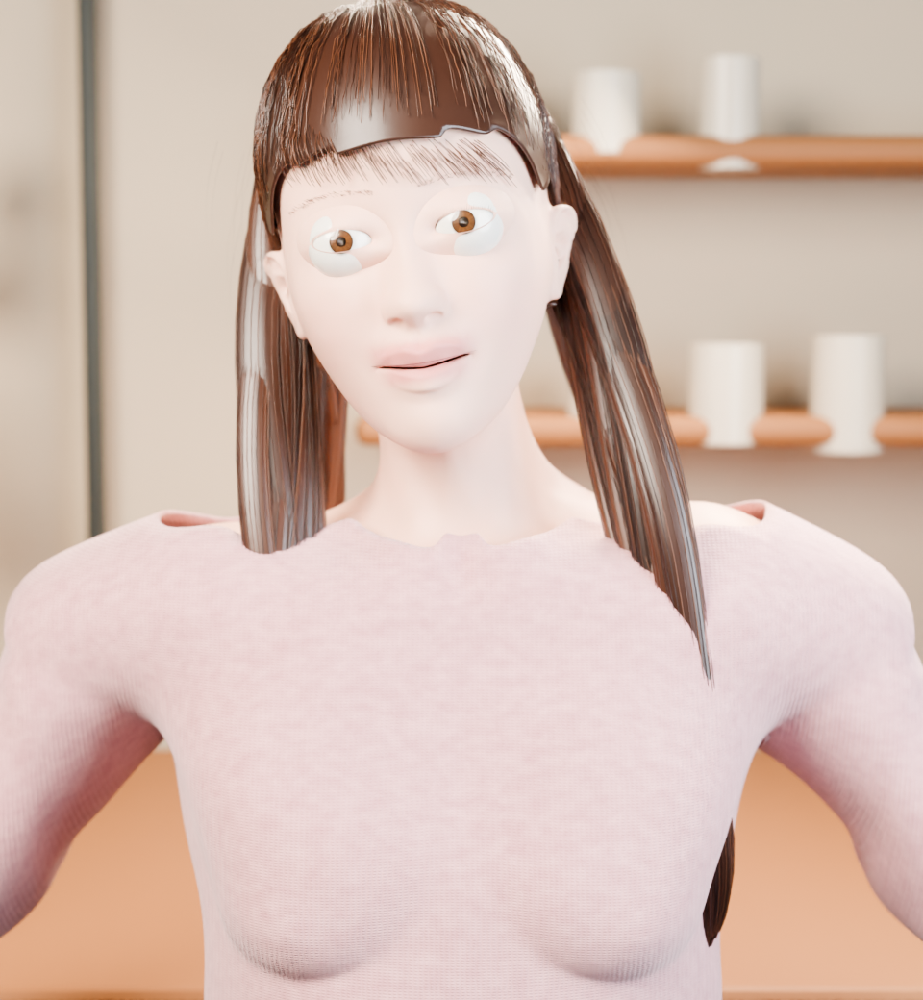
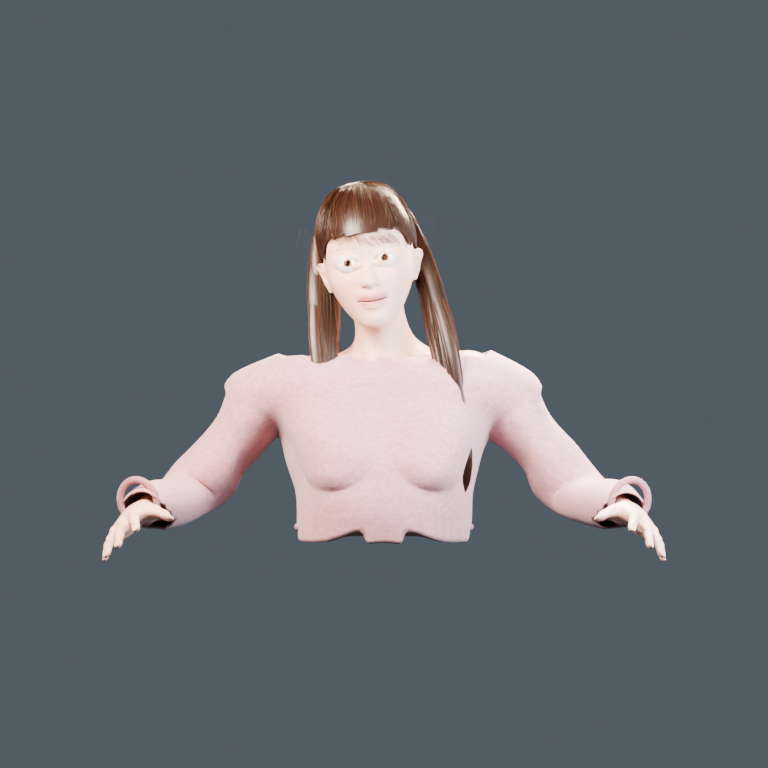
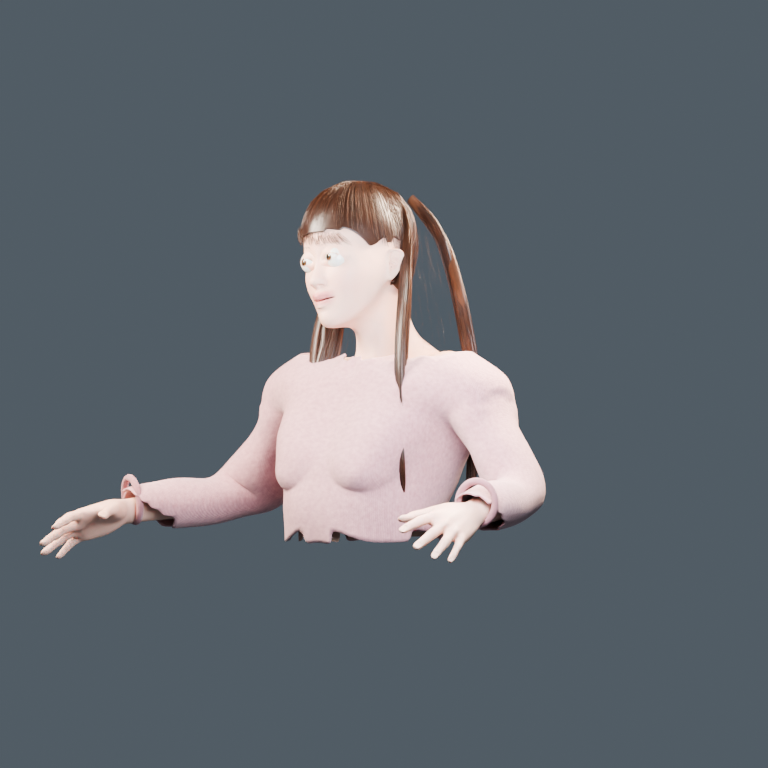
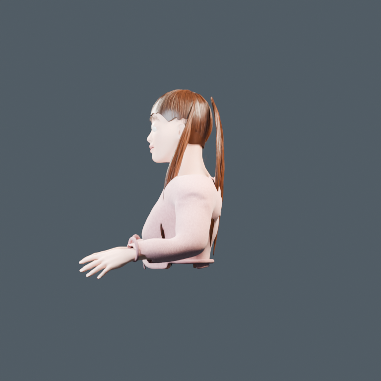
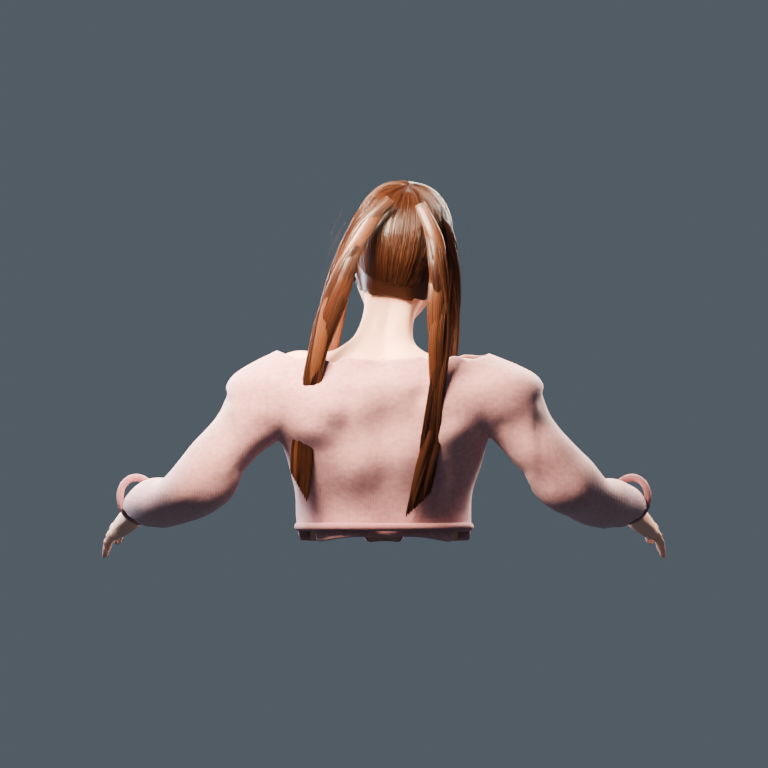

# Kimi K3.1 Pro — 2026-10-25

**初回の写真テクスチャ禁止版が完成しています。写真テクスチャ許可版は未実行です。**

同じ参照写真・CC0ベース・初回プロンプトを使い、Kimi公式APIの
`kimi-k3.1-pro` をOpenCode 1.1.20から実行しました。
モデルのコードで実際のBlender 5.1.1シーンを構築・保存・再オープンし、
Cycles CPU、3スレッド、32サンプル、デノイズありで5方向のPNGを出しています。
外見の採点・順位付け・講評は行いません。

- [HTMLビューアー](../../viewer/index.html) / [開き方](../../viewer/README.md)
- [編集可能なBlenderシーン](procedural/kimi-k3.1-pro/character.blend)
- [閲覧用GLB](procedural/kimi-k3.1-pro/character.glb)
- [実行するコード](procedural/kimi-k3.1-pro/build.py) / [互換修正前のKimi生成コード](procedural/kimi-k3.1-pro/build.kimi-original.py)
- [Kimiの制作メモ](procedural/kimi-k3.1-pro/README.md) / [測定記録](procedural/kimi-k3.1-pro/validation.json)
- [実行・利用量・制約の記録](run.json)

| 元写真 | 初回の完成カット |
| --- | --- |
|  |  |

| 正面 | 斜め | 横 | 背面 |
| --- | --- | --- | --- |
|  |  |  |  |

## 実行上の補助と限界

共通の `PROMPT.md` と元入力は変更していません。元入力・両プロンプトの
7件のSHA-256をマニフェストと照合し、全件一致を確認しました。
公開済み2026-10-14の提出物を変更・再実行していません。

Kimiが共通ベースの確認を繰り返したため、予算と制作完了を優先する運用上の
継続指示を送りました。初期のreasoningは `max`、途中で応答上限を8192へ下げた
際にwriteツールのJSONが途切れたため、Kimiが出力したPythonの完全な行を回収し、
エスケープされた改行を復号しました。Kimiがその233行を読み直して残りを追記しました。
その後のreasoningは `high`、応答上限は32768です。これらの追加指示は
`harness/` に収録しています。全送信履歴が過去のモデルと同じという意味ではありません。

実行時にBlender 5.1.1のPrincipled BSDF入力名が一致せず停止したため、
コーディネーターが `Anisotropic IOR Level` を `Anisotropic` に1か所変更しました。
意図された値は変更していません。Kimi自身が書いた修正前の完成コードも保存しています。
また、診断画像で手先が画面外になるため、4つの診断カメラだけは評価済み頂点から
共通の正投影スケールを計算し、8%の余白を取る技術修正を行いました。
カメラの方向、完成カットのカメラ、人物の頂点・材質は変更していません。
人物の形状・材質のデザインはKimiが生成したままです。上記は実行互換と検査画像の画角の補助です。

Kimiは元写真を画像読み取りツールで実際に読み、ベースメッシュのプレビューも
確認しています。完成した人物のプレビューと最終5画像を確認し、最終の構築・レンダー・
技術検査・GLB書き出しを実行したのはコーディネーターです。
**Kimi自身による完成人物画像の確認・修正ループは、日次上限までに完了していません。**
モデル生成のREADMEとscene-reportはモデル自身の説明であり、この補足が実行範囲の記録です。

保存シーンの再オープン、入力資産の解決、画像寸法、CPU・スレッド・サンプル、
メッシュ数とファイルハッシュを検査しました。Kimiのレポートは曲線の評価メッシュも
含めて566,137頂点です。独立検査の `total_evaluated_mesh_vertices` は元からMESH型の
オブジェクトのみを数えるため値が異なり、髪の曲線は別に記録しています。
寸法は独立検査の `actual_evaluated_character_bounds` を参照してください。
モデルのレポートはオブジェクトの `bound_box` を使っており、曲線を含む実際の評価後頂点の
範囲とは一致しません。診断用4カメラは評価済み頂点をカメラの投影行列で検査し、
全頂点が画像内へ入ることも確認しています。
GLBは人物の4コレクションだけを一時的なメモリ上で書き出し、曲線をメッシュへ変換しました。
元の `.blend` は変更していません。GLBではBlender固有の材質・髪・照明の見え方が異なります。
Blenderの手続き的な服のカラーランプはglTFで表現できないため、GLBだけは
元の材質にKimiが設定したベース色を使います。書き出し時の変換内容は検査JSONに記録しています。

## 費用と写真テクスチャ許可版

**過去の呼び出しを含めたAPI利用上限を$5**に設定しました。
この実行からの購入・追加入金・月額契約はありません。

最初の予算ガードはキャッシュ済み入力まで新規入力として累積したため過大計上になりました。
公式APIのcached-input利用量を反映するよう修正し、過去の呼び出しを再集計しました。
次の呼び出し前には全入力を未キャッシュとして最大出力分とともに確保し、
中断などで利用量が不明な呼び出しは最大額の確保を残しています。
一時APIキーの発行と1回の置き換えは本人承認済みです。秘密値はチャット・Git・
コード・ログ・OpenCodeの永続認証設定へ保存していません。

公式APIは `TPD` 上限1,500,000に対して `current: 1505814` の
`rate_limit_reached_error` を返しました。このため写真テクスチャ許可版は実行していません。
初回のファイルを写真テクスチャ許可版として扱うことや、別モデルへの切り替えはしていません。
残高と日次トークン枠は別の制限です。次の制作には日次枠の回復が必要です。

2026-10-25の公式コンソールで、今回のAPI消費は約$1.02と確認しました。
利用量不明分を含めた安全側の集計も `run.json` に記録しています。

料金・仕様の一次情報（2026-10-25確認）：
[Kimi公式API](https://platform.kimi.ai/)、
[料金説明](https://platform.kimi.ai/docs/pricing/chat)、
[利用制限](https://platform.kimi.ai/docs/pricing/limits)、
[トークン数の事前見積もり](https://platform.kimi.ai/docs/api/estimate)。
