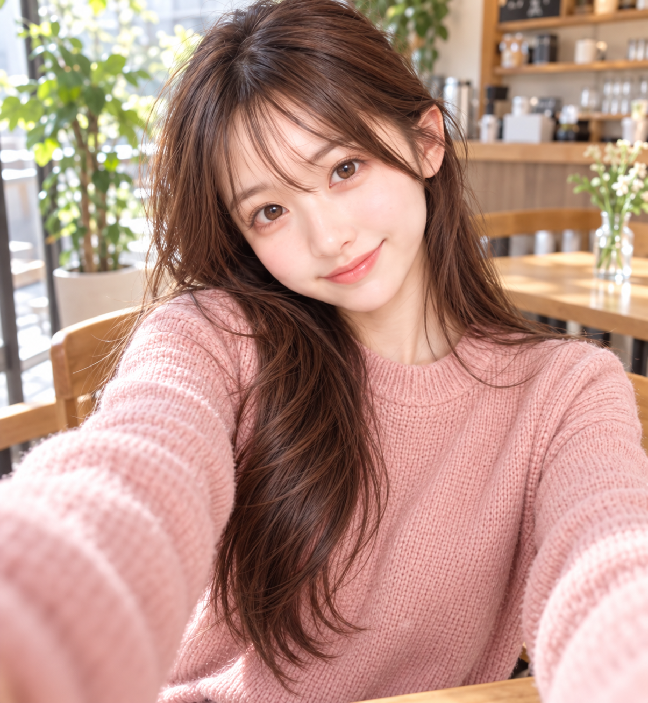
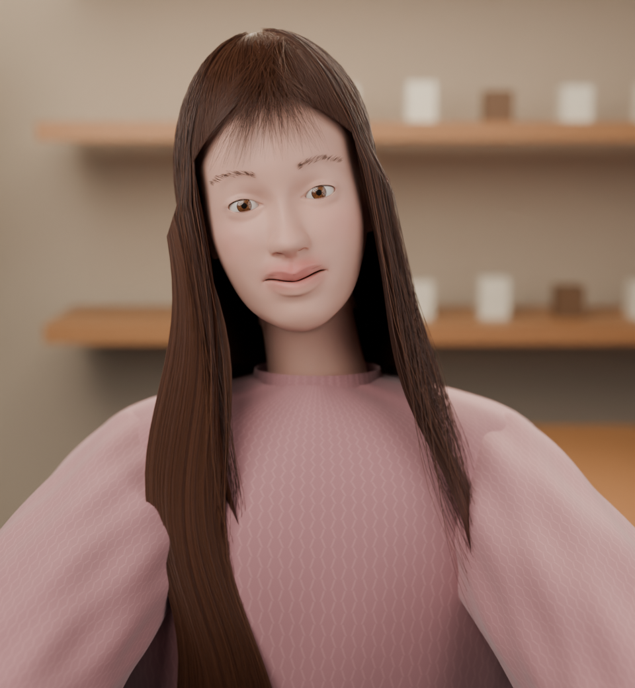
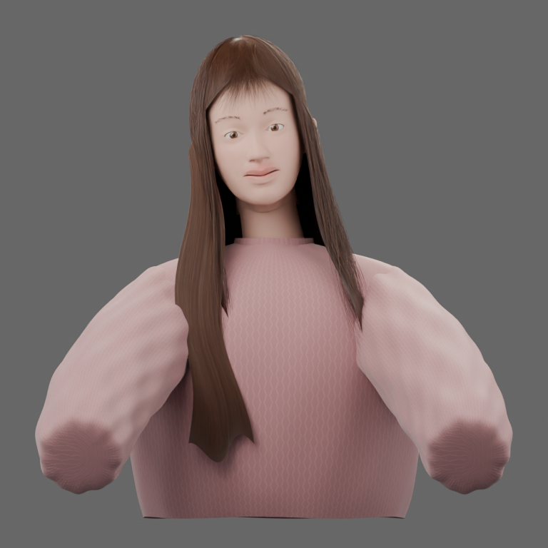
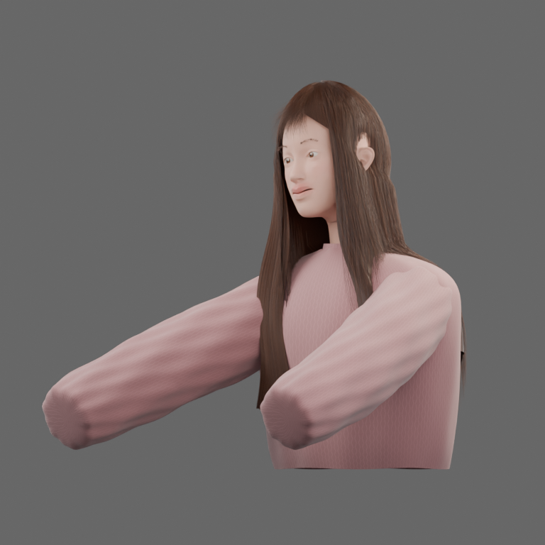
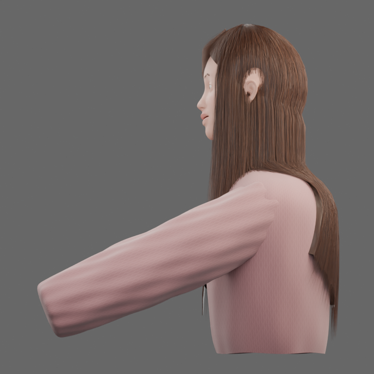
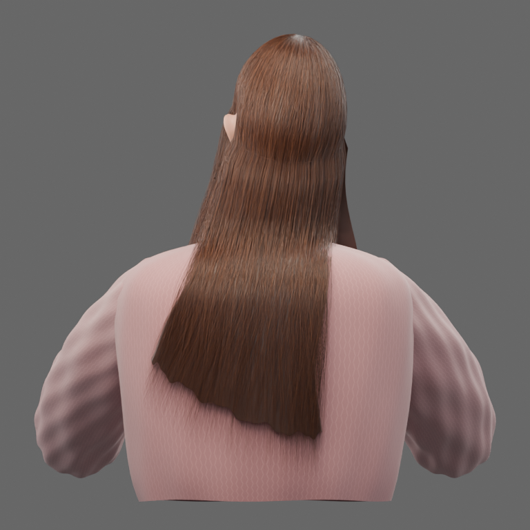

# GPT-6.1 Terra — 2026-10-27

共通の参照写真・CC0ベース・初回の写真テクスチャ禁止プロンプトを使用した、Terraの追加実行です。Mac Studio上で対話版Codex CLI 0.164.0、モデル `gpt-6.1-terra`、reasoning effort `max` を使いました。初回版が完成しています。写真テクスチャ許可版は今回の対象外です。外見の採点・順位付けは行いません。

- [HTMLビューアー](../../viewer/index.html) / [開き方](../../viewer/README.md)
- [編集可能なBlenderシーン](procedural/gpt-6.1-terra/character.blend) / [閲覧用GLB](procedural/gpt-6.1-terra/character.glb)
- [制作コード](procedural/gpt-6.1-terra/build.py) / [レンダーコード](procedural/gpt-6.1-terra/render_views.py) / [レポートコード](procedural/gpt-6.1-terra/report.py)
- [Terraの制作メモ](procedural/gpt-6.1-terra/README.md) / [コーディネーターの検査結果](procedural/gpt-6.1-terra/validation.json)
- [実行条件](run.json) / [継続指示](harness/continuation.md)
- [ビューアーの確認範囲](viewer-checks.json)

| 元写真 | 初回の完成カット |
| --- | --- |
|  |  |

| 正面 | 斜め | 横 | 背面 |
| --- | --- | --- | --- |
|  |  |  |  |

## 制作とコーディネーターの検証

入力5件と共通マニフェストの7件をSHA-256で照合しました。収録した `PROMPT.md` は共通原文とバイト一致します。シェルからモデルへ渡したテキストでは末尾改行1つだけが除かれました。SSH切断後、同じスレッドへ運用上の継続指示を1回だけ送りました。原文と実行環境は `harness/` にあります。

Terraの人物形状・材質、制作コード、元の `.blend` は変更していません。コーディネーターによる互換修正はありません。元の保存シーンを再オープンし、SHA-256が不変であることを確認しました。さらに独立した作業コピーで `build.py → render_views.py → report.py` を実行し、3工程が成功しました。再生成PNGは元のPNGとバイト一致しませんが、各方向の構図と内容を目視で確認し、画像寸法も一致しました。収録した5画像はTerraの元レンダーの画像データを保ち、個人の絶対パスが含まれたPNGメタデータだけを相対パスへ置き換えています。

収録した `character.blend` を `scripts/inspect_scene.py` で再オープンし、`Character` コレクションの人物だけをメモリ上でGLBに書き出しました。元の `.blend` は保存し直していません。GLBもBlenderへ再インポートし、44メッシュが読み込めることを確認しました。Cycles CPU、3スレッド、32サンプル、デノイズ有効、生成画像のパックと入力資産の解決を確認しました。元からMESH型のオブジェクトだけを数える独立検査は192,651評価頂点で、曲線も変換して数えるTerraのレポートは688,685評価頂点です。数え方が異なるため、両値をそのまま記録しています。GLBの書き出しでは24曲線を一時的にメッシュへ変換し、glTFで表現できないセーターの手続き的な色をTerraが設定したベース色で代用しました。髪・材質・照明の見え方は元のBlenderシーンやPNGと異なる場合があります。

完成カットは960×1040、正面・斜め・横・背面は各768×768です。元と再生成の全5画像を開いて確認しました。`validation.json` に入力ハッシュ、再実行の終了結果、ファイルハッシュ、寸法と独立検査を保存しました。技術検査であり、外見の評価ではありません。2026-10-14と2026-10-25の公開済み成果物は変更していません。

ビューアー用のローカル限定サーバーを起動して停止しました。ブラウザーのURLポリシーによりページ観察が拒否されたため、実画面での回転・拡大とモバイル表示は未確認です。両モデルの20リンクとGLB形式、HTML要素、JavaScript構文、モデル切り替えロジックをオフラインで検査し、結果を `viewer-checks.json` に記録しました。

## 再実行と収録範囲

収録ディレクトリを別の作業場所へコピーし、そこから次の順に実行できます。元の収録ファイルに上書きしないでください。

```sh
/Applications/Blender.app/Contents/MacOS/Blender --background --factory-startup --threads 3 --python build.py
/Applications/Blender.app/Contents/MacOS/Blender --background character.blend --threads 3 --python render_views.py
/Applications/Blender.app/Contents/MacOS/Blender --background character.blend --threads 3 --python report.py
```

収録対象はコード、README、課題文、共通入力のコピー、元のシーン、元レンダー5枚のメタデータ修正版、シーンレポート、検査JSON、コーディネーターが書き出したGLBです。`.blend1`、プレビュー中間画像、キャッシュ、実行ログは含めていません。GLBは約36 MB、`.blend` は約1.9 MBで、Kimiと同じくGitで管理できます。コミット前のスキャンで、PNG 5枚の `File` テキストメタデータに個人の絶対パスがあると判明しました。その値だけを `renders/画像名` に置き換え、PNGのIDAT画像データが全件バイト一致することを確認しました。元ファイルと収録版のSHA-256は `validation.json` に記録しています。その他の収録ファイルでは同種のパスは検出されませんでした。

## 成果物の限界

Terraの制作メモにあるとおり、これは手続き的に制作した様式化された上半身モデルです。顔や表情、髪、ニットは近似で、背面・横顔・見えない衣服は1枚の写真からの推定です。袖は閉じた形で手はありません。カフェは簡略化した3D背景です。制作向けのリグや下半身は含まれません。GLBは閲覧用の変換結果であり、編集には `.blend` を使用してください。
