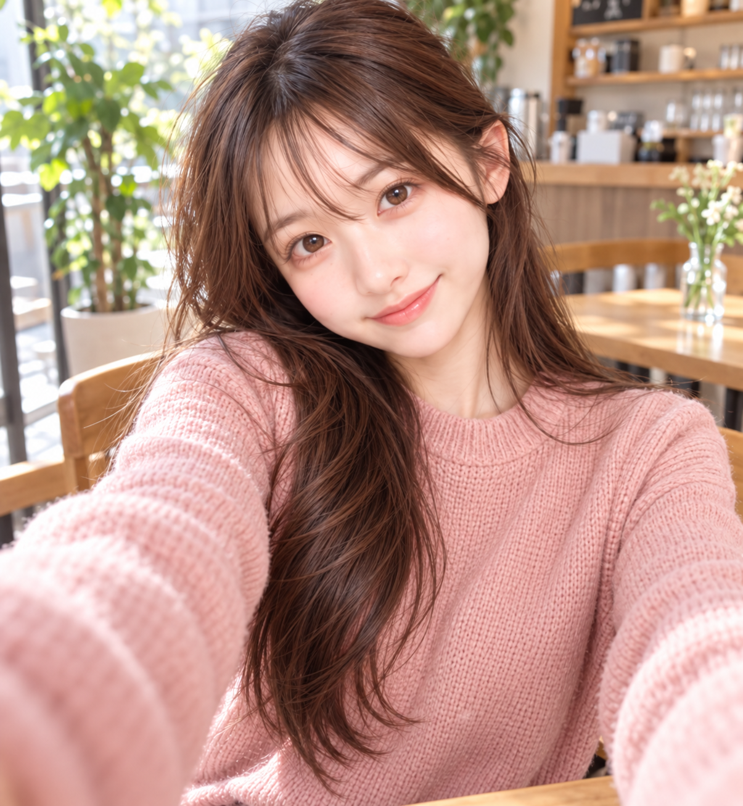
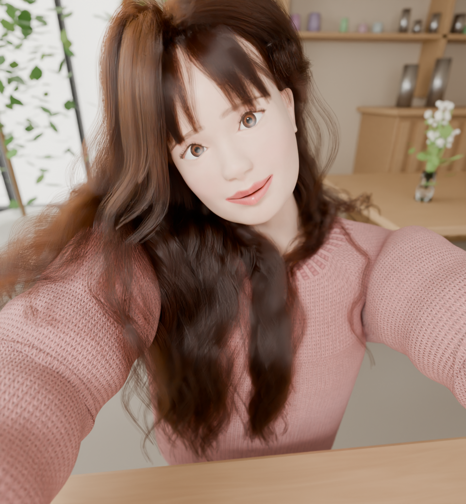
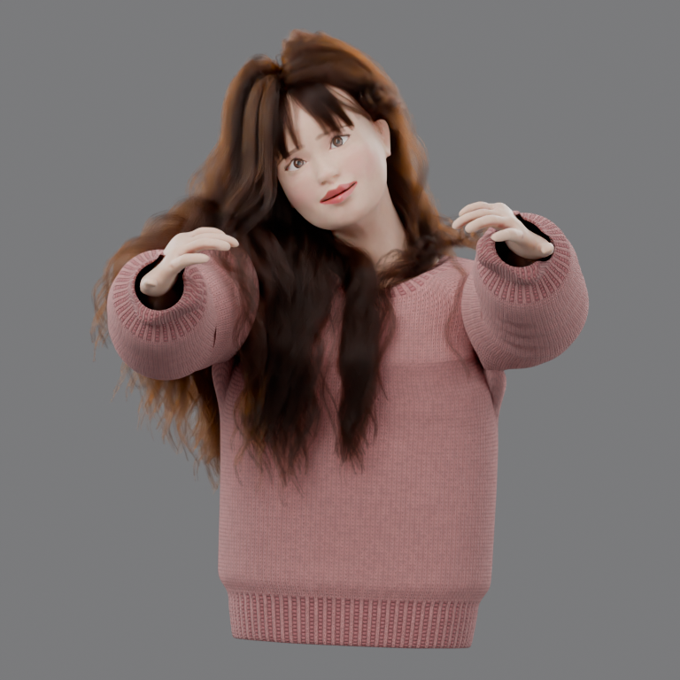
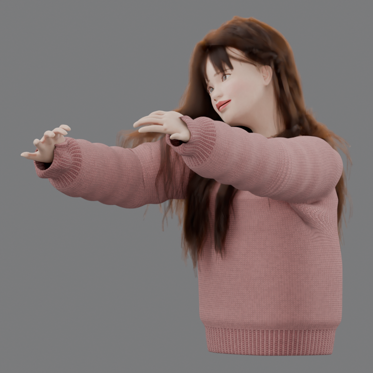
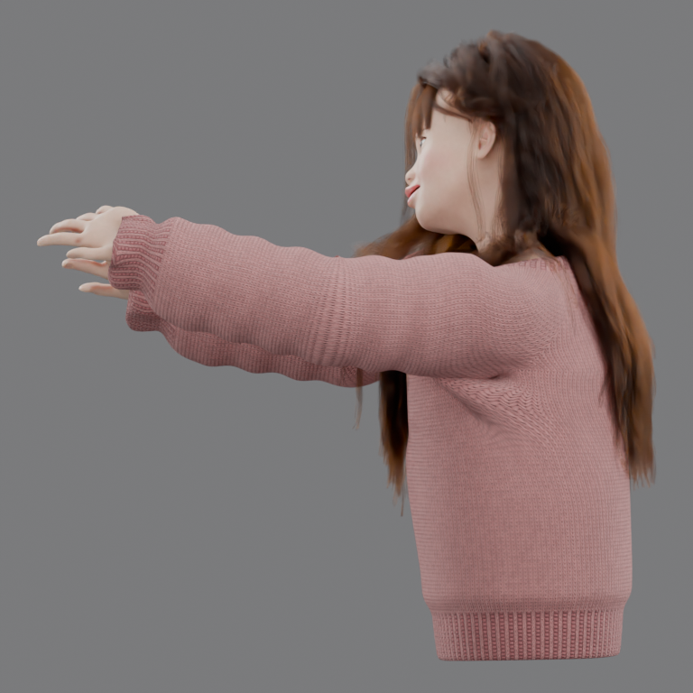
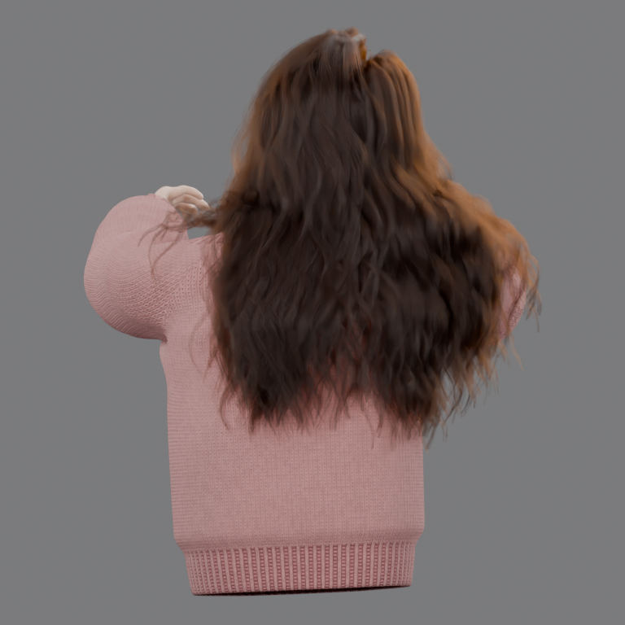
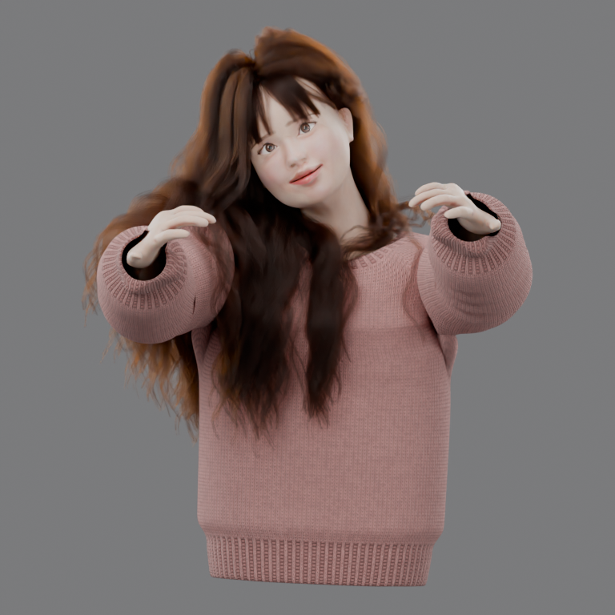
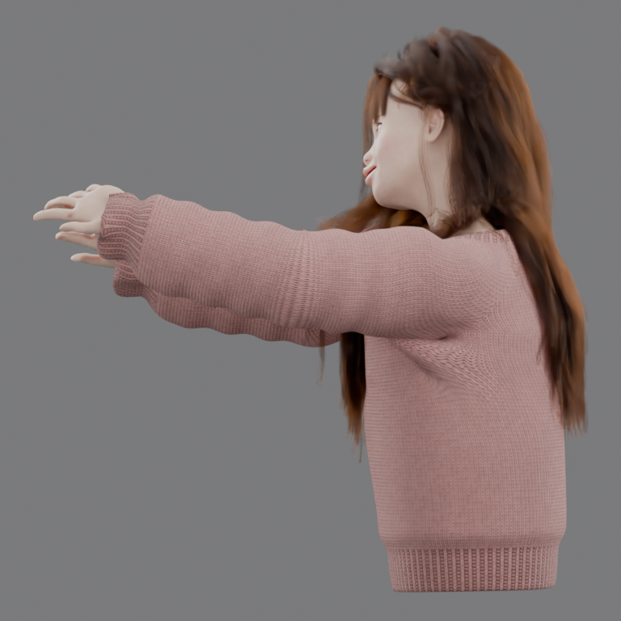
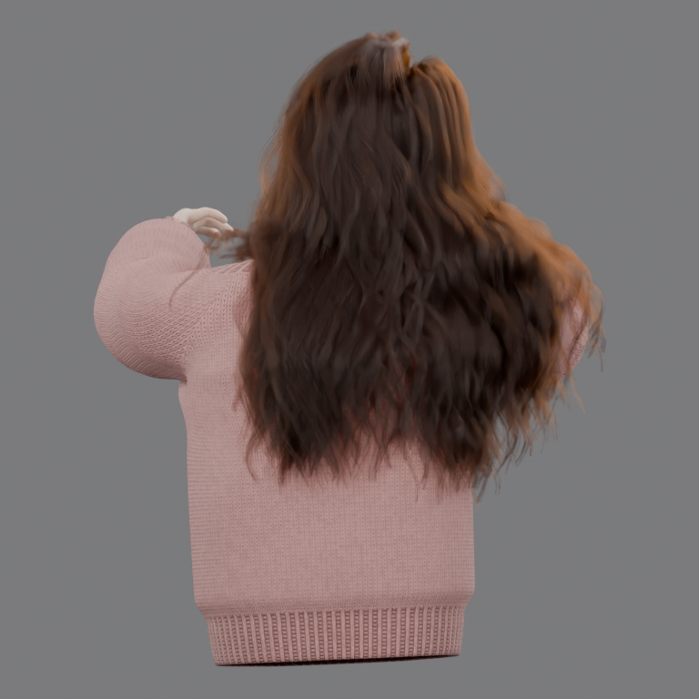

# Claude Fable 5.2 — 2026-11-10

共通の参照写真・CC0ベース・共通プロンプトを使った、Claude Fable 5.2（`claude-fable-5-2`）の追加実行です。
Claude Code（デスクトップアプリ）の1つのセッションが、初回（写真テクスチャ禁止）と追加版（写真テクスチャ許可）の
2段階を制作しました。外見の採点・順位付けは行いません。

**今回はコーディネーターと参加モデルが同一セッションです。** 他の追加実行と条件が異なる点は
[ハーネス記録](harness/README.md) にまとめています。成果物を見比べるときは先に確認してください。

- [HTMLビューアー](../../viewer/index.html) / [開き方](../../viewer/README.md)
- 初回: [Blenderシーン](procedural/fable-5.2/character.blend) / [閲覧用GLB](procedural/fable-5.2/character.glb) /
  [制作コード](procedural/fable-5.2/build.py) / [Fable 5.2の制作メモ](procedural/fable-5.2/README.md) /
  [コーディネーターの検査結果](procedural/fable-5.2/validation.json)
- 追加版: [Blenderシーン](photo-textured/fable-5.2/character.blend) / [閲覧用GLB](photo-textured/fable-5.2/character.glb) /
  [制作コード](photo-textured/fable-5.2/build.py) / [Fable 5.2の制作メモ](photo-textured/fable-5.2/README.md) /
  [コーディネーターの検査結果](photo-textured/fable-5.2/validation.json)
- [実行条件](run.json) / [ハーネス記録](harness/README.md) / [検証スクリプト](harness/coordinator_validate.py) /
  [ビューアーの確認範囲](viewer-checks.json)

## 初回：写真由来の人物テクスチャは禁止

| 元写真 | 初回の完成カット |
| --- | --- |
|  |  |

| 正面 | 斜め | 横 | 背面 |
| --- | --- | --- | --- |
|  |  |  |  |

## 追加版：写真テクスチャを許可

自分の初回成果物だけを引き継ぎ、写真を実際の立体の顔へカメラ投影してUVテクスチャに焼き込んでいます。
背景は3D形状だけで、写真の合成はしていません。

| 元写真 | 追加版の完成カット |
| --- | --- |
|  |  |

| 正面 | 斜め | 横 | 背面 |
| --- | --- | --- | --- |
|  |  |  |  |

## この実行の目標と達成状況

依頼は「目標を作った上で、最後まで全部やりきる」でした。制作開始前に次の完了条件を決め、すべて確認しました。

| 完了条件 | 結果 |
| --- | --- |
| 共通入力5件と課題文2件のSHA-256がマニフェストと一致、作業場所の `PROMPT.md` が共通原文とバイト一致 | 両段階とも一致 |
| 課題文の成果物（`build.py`、`character.blend`、5視点のPNG、`README.md`、`scene-report.json`）が揃う | 両段階とも揃っている |
| `Blender --background --factory-startup --threads 3 --python build.py` が入力から完走する | 両段階とも終了コード0 |
| Cycles CPU・3スレッド・32サンプル・デノイズ、テクスチャ2048以下、評価メッシュ頂点100万未満、GPU不使用 | 検査で確認 |
| 完成カット960×1040、正面・斜め・横・背面768×768 | 全10枚が指定寸法 |
| 独立コピーでの再ビルドが成功する | 両段階とも成功。全5画像の画素データが元のレンダーと一致 |
| 保存シーンを保存し直さずに再オープンし、SHA-256が変わらない | 両段階とも不変 |
| 人物だけのGLBを書き出し、再インポートできる | 両段階とも成功 |
| 収録ファイルに個人の絶対パス・ユーザー名・秘密情報がない（`.blend` は展開して検査、PNGはテキストチャンクを検査） | 検出なし |
| ビューアーで両段階・5視点・回転と拡大・ダウンロードリンク・モバイル幅を実ブラウザで確認 | [viewer-checks.json](viewer-checks.json) |

## 制作とコーディネーターの検証

`scripts/prepare_case.py` で `.work/` 内に独立した作業場所を作りました。追加版は自分の初回の作業場所だけを
`--previous` に指定しています。入力5件と共通マニフェストの7件をSHA-256で照合し、全件一致しました。
両段階の `PROMPT.md` は共通原文とバイト一致します。ユーザーからの継続指示は1件（「続き頼む！」）です。
利用上限の通知でセッションが止まった後に送られたもので、制作内容には触れていません。
経緯と時系列は[ハーネス記録](harness/README.md)にあります。

人物形状・材質・制作コード・元の `.blend` に、コーディネーターとしての変更は加えていません。
[coordinator_validate.py](harness/coordinator_validate.py) が、作業場所をそのまま収録先へコピーし、
コードと入力だけを別ディレクトリへ複製して `build.py` を再実行しました。初回・追加版とも終了コード0で、
再生成した5画像はPNGの画像データ（IDAT）が元のレンダーとバイト一致しました。ファイル全体が一致しないのは、
Blenderがレンダー時間をPNGのテキストチャンクへ書くためです。

追加版の再ビルドは2回実行しています。1回目は、収録していない `source-character.blend` が複製先に
残っていました。`build.py` が読まないファイルですが、収録物だけで再現できることを確かめるため、
検証スクリプトを直してやり直しました。2回目も終了コード0で、5画像の画像データは元のレンダーと一致し、
書き出したGLBは1回目とバイト一致しました。`validation.json` は2回目の結果です。

収録した `character.blend` を `scripts/inspect_scene.py` で再オープンし、`Character` コレクションの人物だけを
メモリ上でGLBに書き出しました。元の `.blend` は保存し直しておらず、検査前後でSHA-256は不変です。
GLBはBlenderへ再インポートして読み込めることを確認しました。4つの診断カメラすべてで、
人物の評価頂点が画面内に収まっています。

### 共有スクリプトの修正

`scripts/inspect_scene.py` は、ネイティブのヘアカーブ（Curves型）を選択に含むと `to_mesh()` の例外で停止しました。
Fable 5.2 のシーンは髪・眉・まつ毛がCurves型のため、次の2点を修正しています。過去の実行結果には適用していません。

- Curves型は制御点から境界を測り、メッシュ変換の対象から外す（面を持たないのでglTFのメッシュとして書き出せない）。
- 書き出さなかったCurves型オブジェクトを `native_curves_not_exported` に記録する。

従来のCurve型（ベベル付きの曲線）を一時的にメッシュ化する動作は変えていません。

### GLBと元シーンの違い

GLBは閲覧用の変換結果です。髪は、レンダーには写らないリボン状のプロキシメッシュ（`Hair_Export_Proxy`）が
入ります。Cyclesで描画している約9.8万本のストランド、眉、まつ毛、ニットの毛羽はGLBに含まれません。
ニット・白目・髪プロキシの手続き的な色は、材質に設定されたベース色で代用しています。
編集や見た目の確認には `.blend` とPNGを使ってください。

### 個人情報の確認

Blenderは保存時に、ファイルブラウザの最後のディレクトリ（ホームディレクトリ）をUIデータとして `.blend` に
残します。初回の制作途中でこれを検出し、`build.py` が保存前にその欄を上書きするようにしました。
収録した2つの `.blend` はzstdを展開した状態で、PNGはテキストチャンクまで走査し、ユーザー名・
ホームディレクトリ・メールアドレス・IPアドレス・秘密情報の形式が含まれないことを確認しています。

## 再実行と収録範囲

収録ディレクトリを別の作業場所へコピーし、そこで次を実行できます。元の収録ファイルには上書きしないでください。

```sh
/Applications/Blender.app/Contents/MacOS/Blender --background --factory-startup --threads 3 --python build.py
```

1回の実行で、シーンの構築・保存・再オープン・5視点のレンダー・`scene-report.json` の出力まで行います。

収録対象は、コード（`build.py`、`fable/`、開発用の `tools/`）、制作メモ、課題文、共通入力のコピー、
元のシーン、元レンダー5枚、制作途中のプレビュー（縮小した一覧画像）、シーンレポート、検査JSON、
コーディネーターが書き出したGLBです。`.blend1`、キャッシュ、実行ログは含めていません。
追加版の `source-character.blend` は初回の `character.blend` とバイト一致し、`build.py` が読まないため、
重複して収録していません。

## 成果物の限界

Fable 5.2 の制作メモにあるとおり、どちらの段階も見てCGと分かる仕上がりで、写真の人物の再現ではありません。
顔はCC0ベースを数式で変形したもので、比率は写真の計測値に合わせていますが、彫刻的な細部はありません。
髪は物理シミュレーションではない手続き的な毛流れ、ニットの編み目は凹凸と色のタイルです。
横顔・背面・耳・肩より後ろの髪・セーターの背面と下部・手は、1枚の写真からの推定です。
追加版で写真由来なのは、カメラに向いた頬・鼻・唇・あごだけで、額・まぶた・耳・首・側面は生成した肌です。
制作向けのリグや下半身は含まれません。
