# GPT-6.2 Astra / GPT-6.2 Sol — 2026-11-18

共通の参照写真・CC0ベース・共通プロンプトを使った、GPT-6.2 Astra（`gpt-6.2-astra`）と
GPT-6.2 Sol（`gpt-6.2-sol`）の追加実行です。どちらも Codex CLI（0.167.2）のエージェント実行が、
初回（写真テクスチャ禁止）を制作しました。外見の採点・順位付けは行いません。

**今回はコーディネーターと参加モデルが別セッションです。** コーディネーター（Muse）が作業場所の準備と
起動・監視・検証を行い、制作は Codex CLI 上の各モデルが単独で行いました。実行条件の詳細は
[ハーネス記録](harness/README.md) にまとめています。

今回の指定により、サービスティアは通常の **Fast**（セッション記録では `priority`）を使い、
普段の Ultrafast は使っていません。指定方法と確認結果はハーネス記録に明記しています。

## GPT-6.2 Astra

- 初回: [Blenderシーン](procedural/gpt-6.2-astra/character.blend) / [閲覧用GLB](procedural/gpt-6.2-astra/character.glb) /
  [制作コード](procedural/gpt-6.2-astra/build.py) / [Astra の制作メモ](procedural/gpt-6.2-astra/README.md) /
  [コーディネーターの検査結果](procedural/gpt-6.2-astra/validation.json)
- 実行時間: 08:18:22 → 09:31:15 JST（4,373秒）、exit_code 0
- コスト: Codex 利用枠での実行（API直接課金なし）。トークン実績（入力 17,756,547＝うちキャッシュ 17,540,096、
  出力 106,112）から Fast の API レート（標準の2倍）で換算した推定で約 $25.98、Codex クレジット換算で約 325 credits。

| 元写真 | 初回の完成カット |
| --- | --- |
|  | 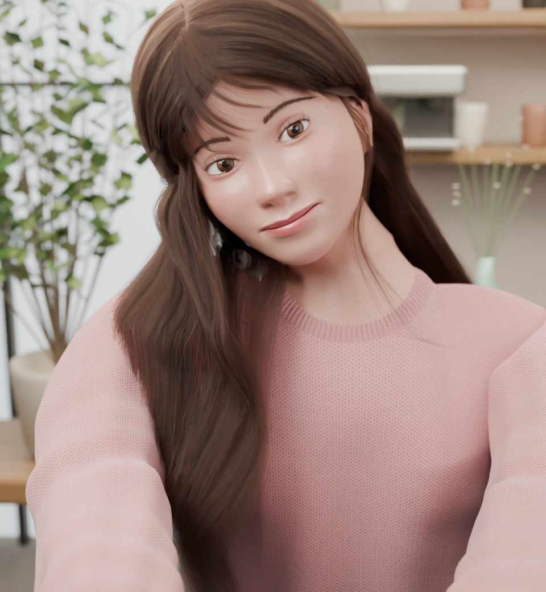 |

| 正面 | 斜め | 横 | 背面 |
| --- | --- | --- | --- |
| 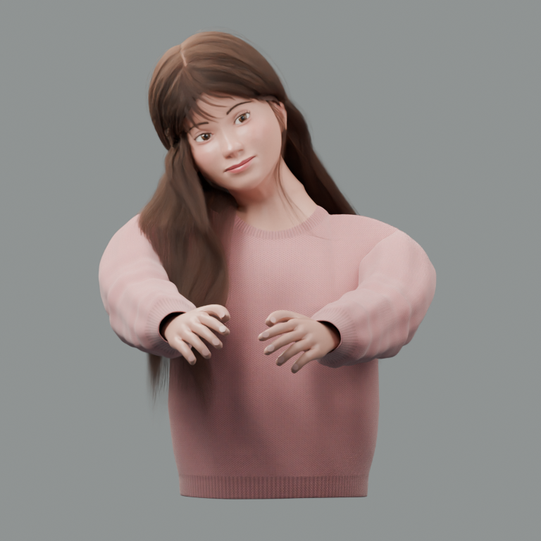 | 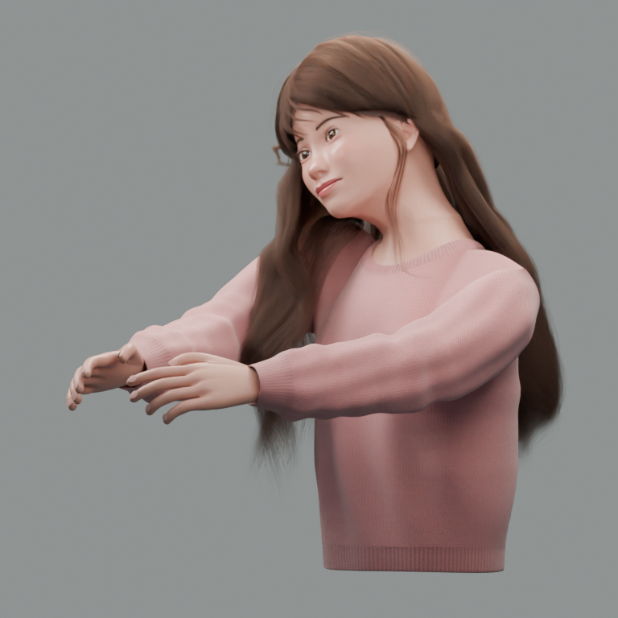 | 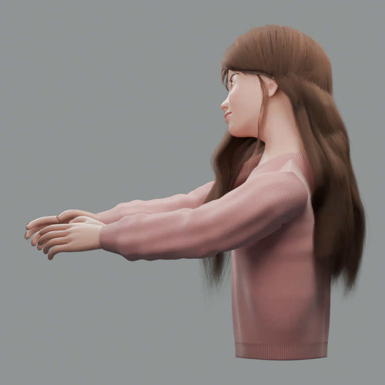 | 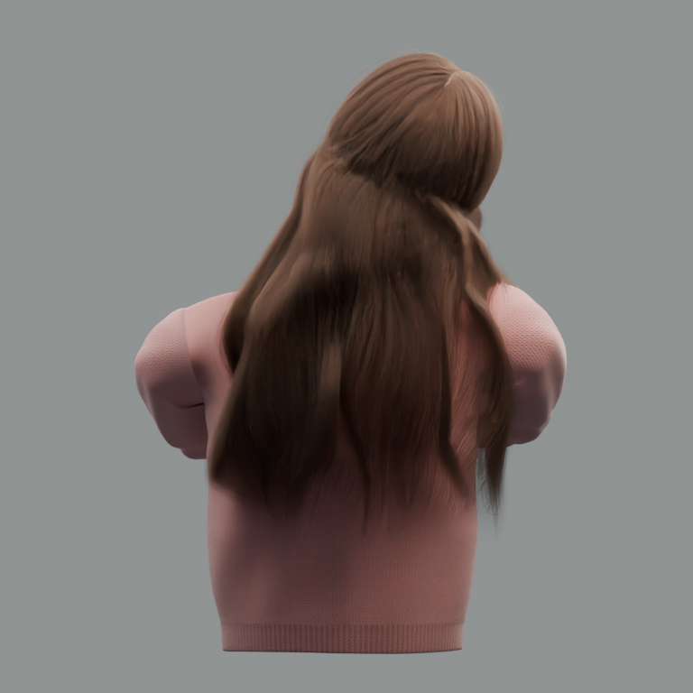 |

## GPT-6.2 Sol

- 初回: [Blenderシーン](procedural/gpt-6.2-sol/character.blend) / [閲覧用GLB](procedural/gpt-6.2-sol/character.glb) /
  [制作コード](procedural/gpt-6.2-sol/build.py) / [Sol の制作メモ](procedural/gpt-6.2-sol/README.md) /
  [コーディネーターの検査結果](procedural/gpt-6.2-sol/validation.json)
- 実行時間: 09:31:41 → 09:57:11 JST（1,530秒）、exit_code 0
- コスト: Codex 利用枠での実行（API直接課金なし）。トークン実績（入力 8,603,295＝うちキャッシュ 8,414,592、
  出力 93,196）から Fast の API レートで換算した推定で約 $4.30、Codex クレジット換算で約 54 credits。

| 元写真 | 初回の完成カット |
| --- | --- |
|  | 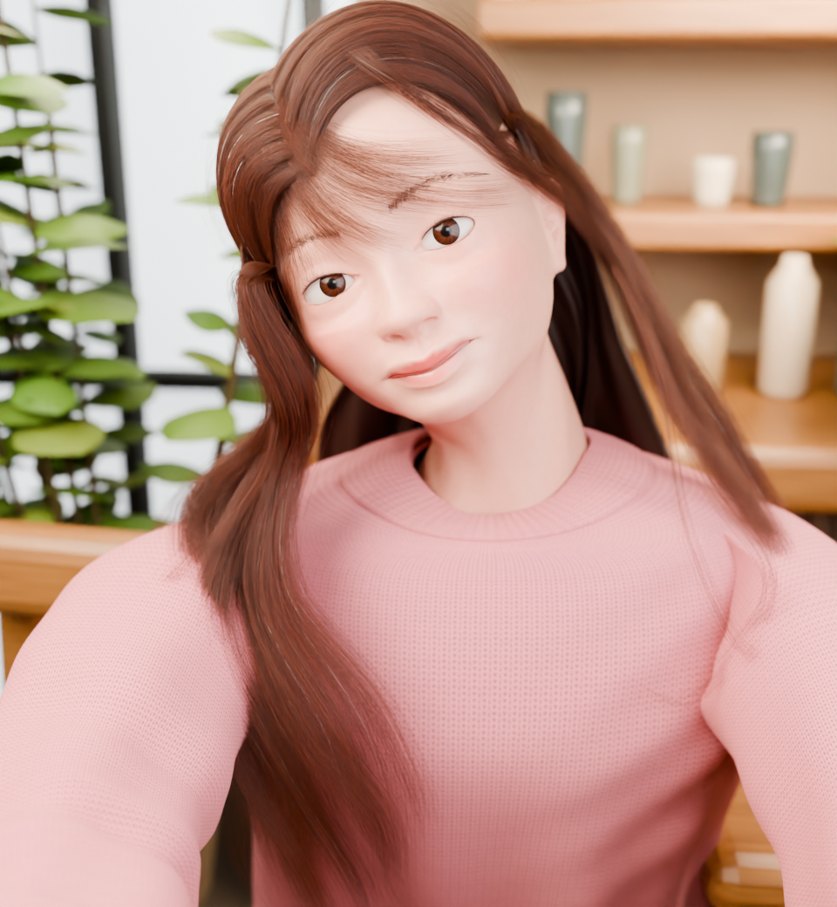 |

| 正面 | 斜め | 横 | 背面 |
| --- | --- | --- | --- |
|  | 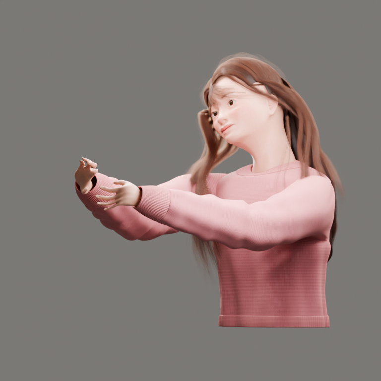 | 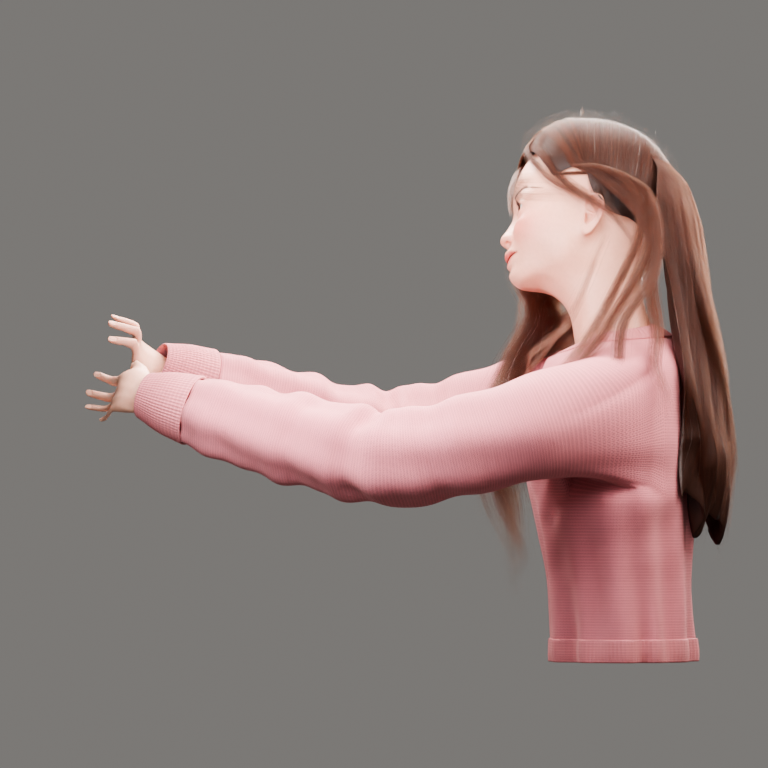 | 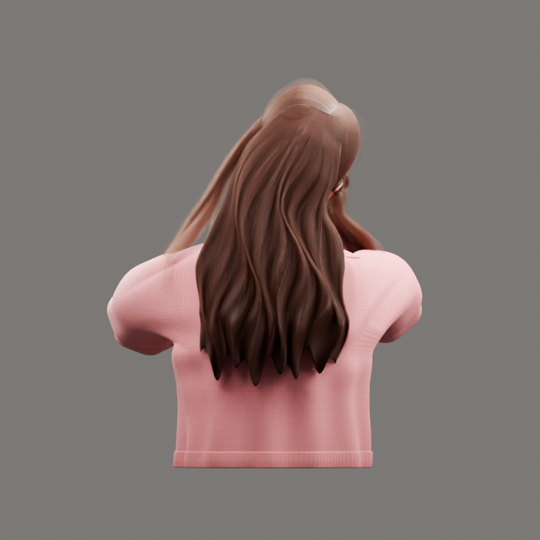 |

- [実行条件](run.json) / [ハーネス記録](harness/README.md) / [検証スクリプト](harness/coordinator_validate.py)

## この実行の目標と達成状況（両モデル共通）

| 完了条件 | 結果 |
| --- | --- |
| 共通入力と課題文のSHA-256がマニフェストと一致、作業場所の `PROMPT.md` が共通原文とバイト一致 | 一致（各 validation.json） |
| 課題文の成果物（`build.py`、`character.blend`、5視点のPNG、`README.md`、`scene-report.json`）が揃う | 揃っている |
| 独立コピーでの再実行が完走する（Astra: `build.py`→`render.py`→`report.py`、Sol: `build.py`→`render.py`→`report_scene.py`） | 両モデルとも全ステップ終了コード0（Astra 147.1秒、Sol 91.3秒） |
| 再生成した5画像の画素データ（IDAT）が元レンダーと一致 | 両モデルとも全5枚一致 |
| Cycles CPU・3スレッド・32サンプル・デノイズ、テクスチャ2048以下、GPU不使用 | 検査で確認（各 validation.json） |
| 完成カット960×1040、正面・斜め・横・背面768×768 | 全5枚が指定寸法 |
| 保存シーンを保存し直さずに再オープンし、SHA-256が変わらない | 不変（各 validation.json） |
| 人物だけのGLBを書き出し、再インポートできる | 成功（Astra: 18メッシュ、Sol: 15メッシュ） |
| 収録ファイルのプライバシースキャン | 秘密情報は両モデルとも検出なし。Astra はスキャン自体もクリーン。Sol は `character.blend` と各PNGのメタデータ（レンダー時のFileパス）に Mac のユーザー名を含む絶対パスが残っている。これは Kimi・Terra・Carbon の公開済み収録物にも同様に含まれているもので、今回も制作物そのままを収録した（詳細は run.json の privacy）。 |

## 追加版について

写真テクスチャ許可版（第2段階）は今回未実施です。実施するかどうかは本人の判断で決めます。

## 成果物の限界

両モデルの制作メモにあるとおり、見てCGと分かる仕上がりで、写真の人物の再現ではありません。
顔はCC0ベースを手続き的に変形したもので、横顔・背面・手などは1枚の写真からの推定です。
制作向けのリグや下半身は含まれません。

## Gemini 4 Carbon / Gemini 4 Hydrogen（同日追加）

同じ共通入力・共通プロンプトで、Gemini 4 Carbon と Gemini 4 Hydrogen の初回（写真テクスチャ禁止）も同日に実行しました。コーディネーターは GPT-6.2 実行とは別の Muse セッションで、実行条件の詳細は[Gemini分のハーネス記録](harness/README-gemini.md)にまとめています。外見の採点・順位付けは行いません。

### Gemini 4 Carbon

- 初回: [Blenderシーン](procedural/gemini-4-carbon/character.blend) / [閲覧用GLB](procedural/gemini-4-carbon/character.glb) / [制作コード](procedural/gemini-4-carbon/build.py) / [Carbon の制作メモ](procedural/gemini-4-carbon/README.md) / [コーディネーターの検査結果](procedural/gemini-4-carbon/validation.json)
- 実行時間: 09:31:34 → 11:05:29 JST（5,635秒）、exit_code 0
- コスト: API従量課金。トークン実績（入力 16,153,607＝うちキャッシュ 13,807,278、出力 213,407）から導入期レートで換算した推定で約 $8.21。
- 再ビルド（164.5秒、終了コード0）で再生成した5画像の画素データは元レンダーと全て一致しました。

| 元写真 | 初回の完成カット |
| --- | --- |
|  |  |

| 正面 | 斜め | 横 | 背面 |
| --- | --- | --- | --- |
| 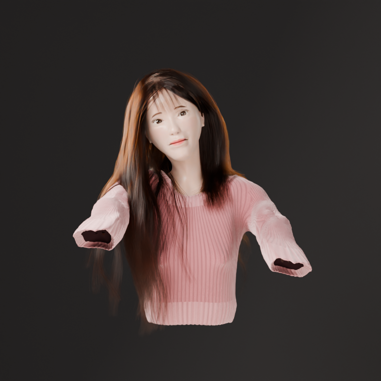 | 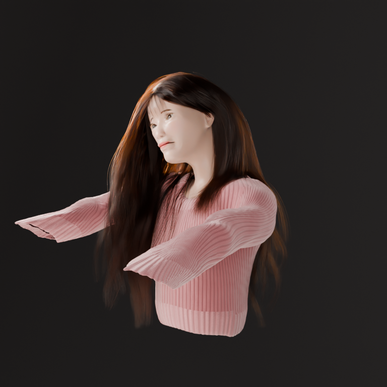 | 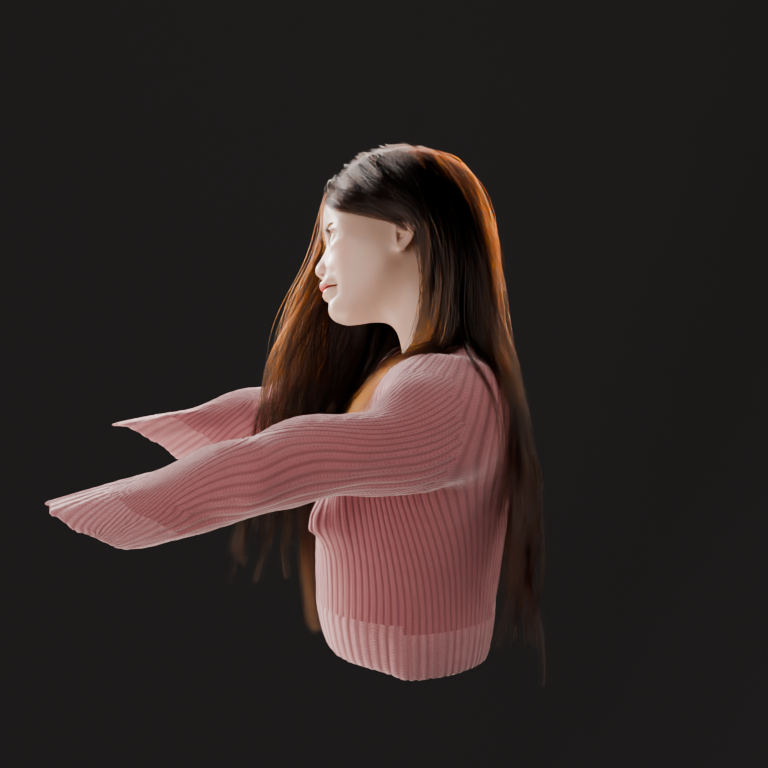 | 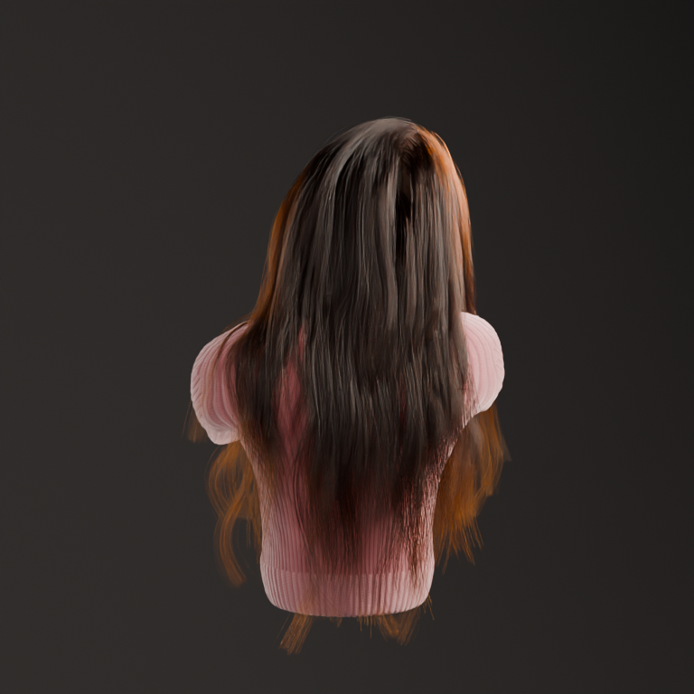 |

### Gemini 4 Hydrogen

- 初回: [Blenderシーン](procedural/gemini-4-hydrogen/character.blend) / [閲覧用GLB](procedural/gemini-4-hydrogen/character.glb) / [制作コード](procedural/gemini-4-hydrogen/build.py) / [Hydrogen の制作メモ](procedural/gemini-4-hydrogen/README.md) / [コーディネーターの検査結果](procedural/gemini-4-hydrogen/validation.json)
- 実行時間: 09:35頃 → 11:11頃 JST（約96分、対話TUIのため終了コードなし）
- コスト: Google AI Ultra プランの利用枠での実行（API直接課金なし）。トークン使用量は取得できません。
- 再ビルド（80.9秒、終了コード0）で5画像とも指定寸法で再生成されましたが、画素データは元レンダーと一致しませんでした（手続き的な毛髪・ファズ要素が画素単位で再現しないため）。

| 元写真 | 初回の完成カット |
| --- | --- |
|  | 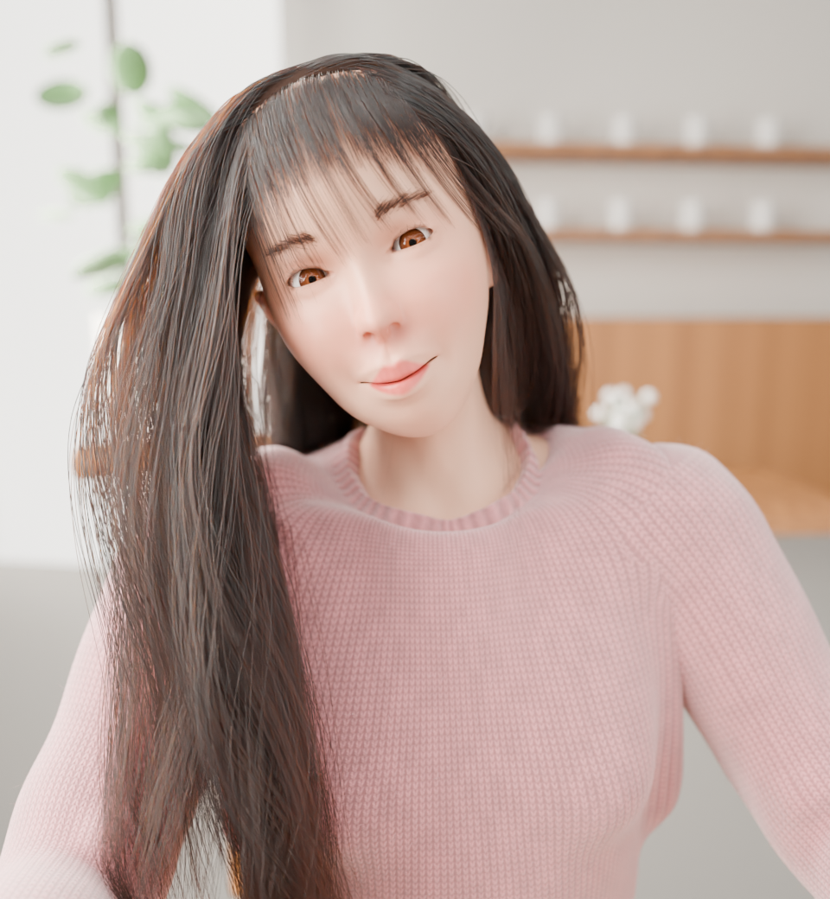 |

| 正面 | 斜め | 横 | 背面 |
| --- | --- | --- | --- |
| 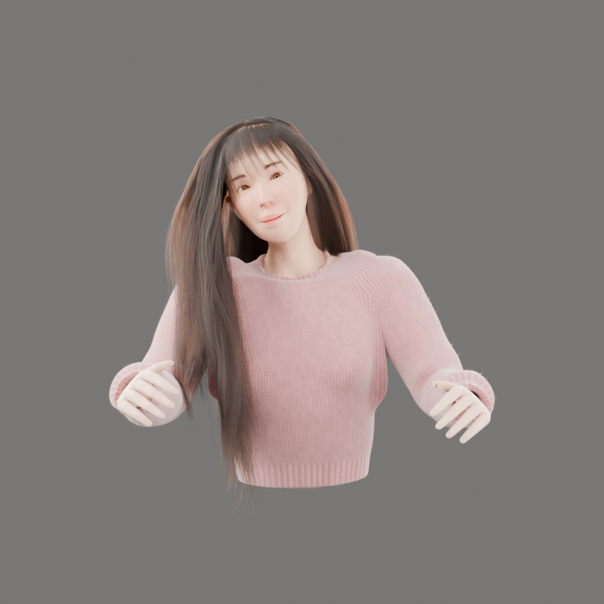 | 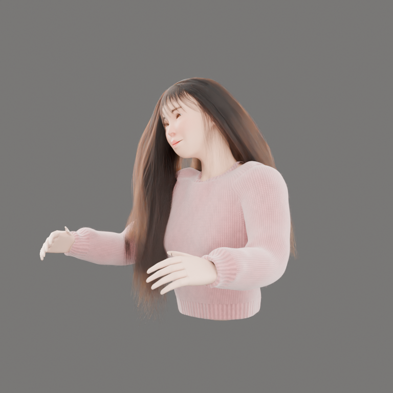 | 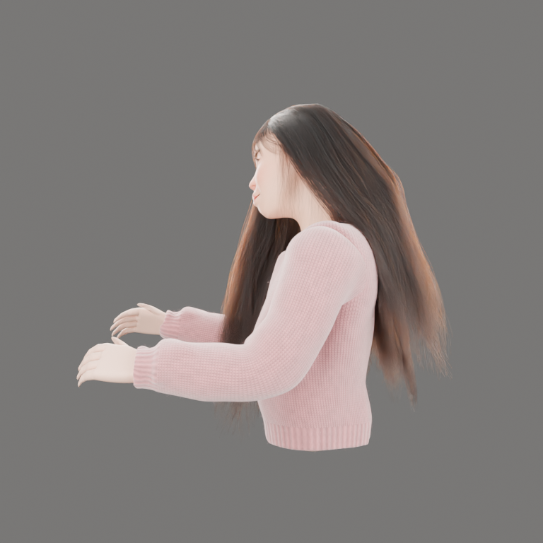 | 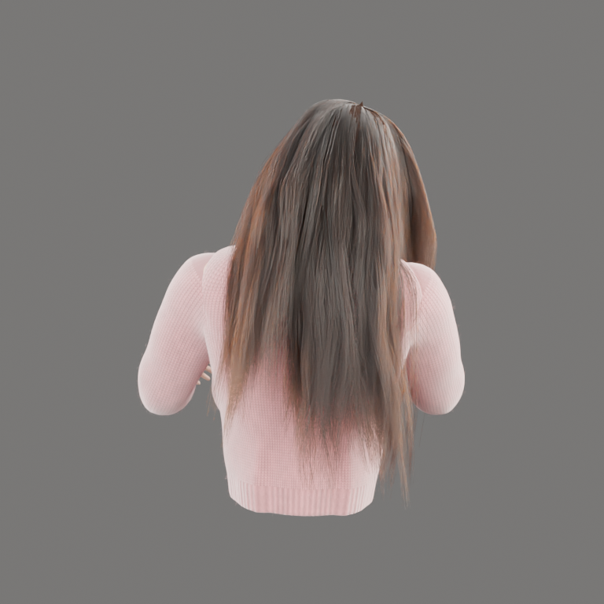 |
