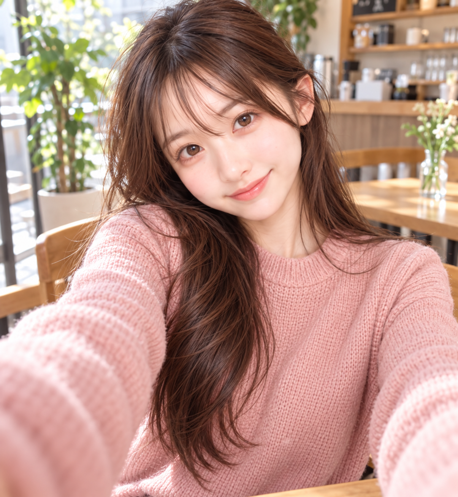
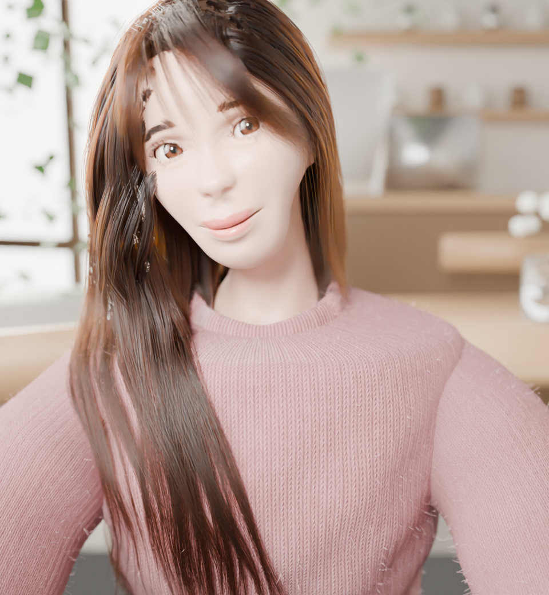
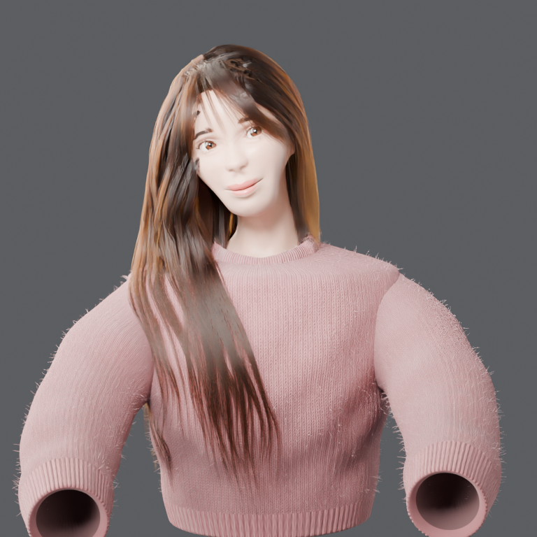
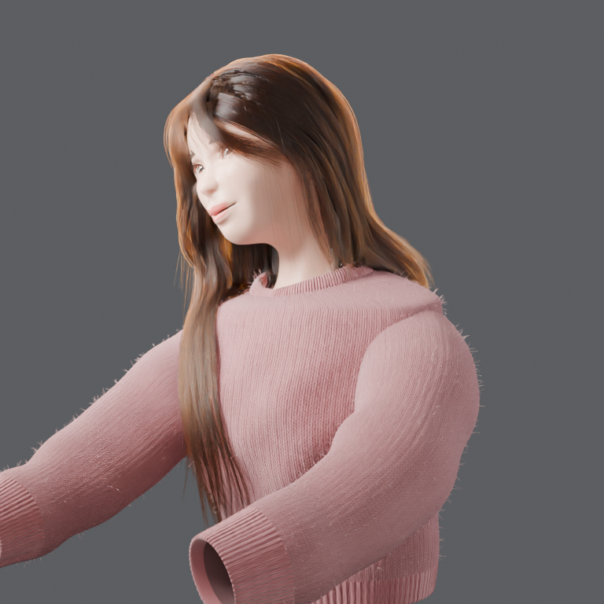
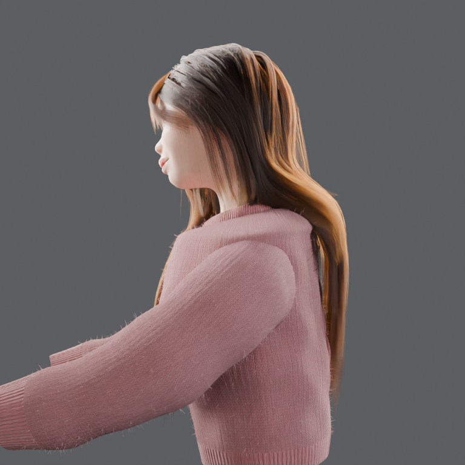
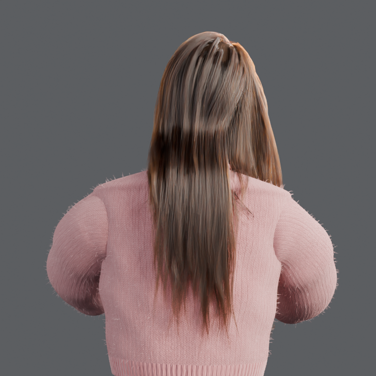

# Gemini 4 Neon — 2026-11-19

共通の参照写真・CC0ベース・共通プロンプトを使った、Gemini 4 Neon（`gemini-4-neon`）の追加実行です。
Gemini CLI（0.68.0）のエージェント実行が、初回（写真テクスチャ禁止）を制作しました。
外見の採点・順位付けは行いません。

**今回はコーディネーターと参加モデルが別セッションです。** コーディネーター（Muse）が作業場所の準備と
起動・監視・検証を行い、制作は Gemini CLI 上のモデルが単独で行いました。実行条件の詳細は
[ハーネス記録](harness/README.md) にまとめています。

実行は同一セッションの3試行に分かれました。試行1・試行2は、API からの空の応答で CLI がターンの終了と
みなして途中で終わったため、コーディネーターが同じセッションを再開して継続させました（モデルの制作内容
への変更は加えていません）。経緯の詳細はハーネス記録に明記しています。

## Gemini 4 Neon

- 初回: [Blenderシーン](procedural/gemini-4-neon/character.blend) / [閲覧用GLB](procedural/gemini-4-neon/character.glb) /
  [制作コード](procedural/gemini-4-neon/build.py) / [Neon の制作メモ](procedural/gemini-4-neon/README.md) /
  [コーディネーターの検査結果](procedural/gemini-4-neon/validation.json)
- 実行時間: 10:14:58 → 11:08:34 JST（3試行の合計 3,148秒、いずれも exit_code 0）
- コスト: API従量課金。トークン実績（入力 11,216,943＝うちキャッシュ 10,048,536、
  出力 147,928）から、Gemini 4 Carbon と同じ導入期レートで換算した推定で約 $4.82
  （Neon 単独のレート表は未確認のため、レートの流用は仮定です）。

| 元写真 | 初回の完成カット |
| --- | --- |
|  |  |

| 正面 | 斜め | 横 | 背面 |
| --- | --- | --- | --- |
|  |  |  |  |

- [実行条件](run.json) / [ハーネス記録](harness/README.md) / [検証スクリプト](harness/coordinator_validate.py)

## この実行の目標と達成状況

| 完了条件 | 結果 |
| --- | --- |
| 共通入力と課題文のSHA-256がマニフェストと一致、作業場所の `PROMPT.md` が共通原文とバイト一致 | 一致（validation.json） |
| 課題文の成果物（`build.py`、`character.blend`、5視点のPNG、`README.md`、`scene-report.json`）が揃う | 揃っている |
| 独立コピーでの再実行が完走する（`build.py` のみ） | 終了コード0（119.8秒） |
| 再生成した5画像の画素データ（IDAT）が元レンダーと一致 | 全5枚一致 |
| Cycles CPU・3スレッド・32サンプル・デノイズ、テクスチャ2048以下、GPU不使用 | 検査で確認（validation.json） |
| 完成カット960×1040、正面・斜め・横・背面768×768 | 全5枚が指定寸法 |
| 保存シーンを保存し直さずに再オープンし、SHA-256が変わらない | 不変（validation.json） |
| 人物だけのGLBを書き出し、再インポートできる | 成功（14メッシュ） |
| 収録ファイルのプライバシースキャン | 秘密情報は検出なし。`character.blend` と各PNGのメタデータ（レンダー時のFileパス）に Mac のユーザー名を含む絶対パスが残っている。これは Sol・Carbon・Hydrogen の公開済み収録物にも同様に含まれているもので、今回も制作物そのままを収録した（詳細は run.json の privacy）。 |

## 追加版について

写真テクスチャ許可版（第2段階）は今回未実施です。実施するかどうかは本人の判断で決めます。

## 成果物の限界

制作メモにあるとおり、見てCGと分かる仕上がりで、写真の人物の再現ではありません。
顔はCC0ベースを手続き的に変形したもので、横顔・背面・手などは1枚の写真からの推定です。
制作向けのリグや下半身は含まれません。
